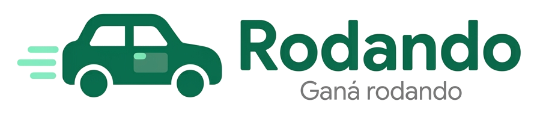

<p align="center"></p>

# Rodando

App Android para que conductores particulares del AMBA ganen un ingreso extra con su auto haciendo sus recorridos de siempre. El conductor lleva publicidad en vinilo, registra cada viaje con foto y GPS, y ve cuánto gana, aun sin conexión.

Trabajo Práctico Obligatorio — Desarrollo de Aplicaciones I (UADE), 2.º cuatrimestre 2026.

## Equipo

| Integrante | Rol principal |
| --- | --- |
| Tobías Juárez | Arquitectura, persistencia e integración |
| Matías Fernández | UI / UX |
| Lucas Casas | Sensores y testing |

## Requisitos funcionales (v1)

- **RF01** — Iniciar un viaje con foto del vinilo, verificada en el teléfono (hasta 3 intentos; si no, viaje "En revisión").
- **RF02** — Finalizar un viaje con foto; se calcula distancia y duración.
- **RF03** — Consultar el historial de viajes, aun sin conexión.
- **RF04** — Ver la ganancia del mes, confirmada (viajes aprobados) y estimada (más los que esperan aprobación): fijo mensual según el vinilo, entero con 12 días con viajes y proporcional por debajo, + monto por km con la tarifa de cada viaje (tope de 1.500 km). No hay mínimo de km, para no incentivar recorridos extra.

### Estados de un viaje

Cada viaje tiene dos estados independientes:

| Envío (técnico) | Verificación (negocio) |
| --- | --- |
| **Sin enviar**: está solo en el teléfono. | **Por aprobar**: la foto se reconoció; falta que el equipo lo apruebe. |
| **Enviado**: llegó al servidor. | **En revisión**: la foto no se reconoció; el equipo la revisa a mano. |
| | **Aprobado**: se cobra. |
| | **Rechazado** / **No computable** (menos de 0,5 km): queda registrado pero no se paga. |

Un viaje enviado puede seguir sin aprobar. Cada viaje guarda la tarifa por km vigente al iniciarse, así un cambio de tarifa no altera lo ya recorrido.

## Tecnologías

Kotlin · Jetpack Compose + Material 3 · ViewModel + Coroutines + StateFlow · Navigation Compose · Room · DataStore · Retrofit · WorkManager · Fused Location · CameraX · ML Kit · osmdroid · JUnit.

Las dependencias se agregan a medida que se implementa cada requisito.

## Arquitectura

MVVM con principios de Clean Architecture y estrategia Offline First (Room es la fuente de verdad de la UI).

```
UI (Compose) → ViewModel → Caso de uso → Repositorio → Room / API / Sensores
```

```
app/src/main/java/com/rodando/app/
├── presentation/      # Pantallas Compose, ViewModels, UiState, tema
│   ├── common/        # UiState y componentes compartidos (estado vacío)
│   ├── navegacion/    # Barra inferior y NavHost (Inicio, Historial, Ganancias)
│   ├── login/         # Inicio de sesión contra la API simulada
│   ├── inicio/        # Campaña activa, vinilo y resumen del mes
│   ├── foto/          # RF01 / RF02: foto del vinilo al iniciar y al finalizar
│   ├── encurso/       # RF01: viaje en curso con tiempo, distancia y recorrido
│   ├── guardado/      # RF02: confirmación del viaje guardado
│   ├── historial/     # RF03: lista de viajes agrupada por día
│   ├── detalle/       # RF03: detalle del viaje con el recorrido
│   ├── ganancias/     # RF04: ganancia estimada y barras de objetivos
│   └── theme/         # Paleta de colores del diseño (Material 3)
├── domain/            # Kotlin puro: no depende de Android
│   ├── model/         # Viaje, Campania, PuntoGps, Vinilo, Sesion, ResumenGanancia, ObjetivoMensual
│   ├── repository/    # Interfaces de repositorio
│   └── usecase/       # Reglas de negocio (iniciar y finalizar viaje, distancia, ganancia, intentos de foto)
└── data/
    ├── local/         # Room (entidades, DAO, mappers), sesión en DataStore y viajes de ejemplo
    ├── remote/        # Retrofit (API simulada), DTOs y preparación de fotos para enviar
    ├── sync/          # WorkManager: envío de viajes y consulta de aprobaciones
    ├── sensors/       # GPS (Fused Location), servicio en primer plano del viaje, permisos y fotos
    └── repository/    # Implementaciones de los repositorios
```

## Cómo ejecutar

1. Levantar la API simulada: instalar [Node](https://nodejs.org) (una vez) y, en una terminal dentro de `api-mock/`, correr `node server.js`. Funciona igual en Mac y en Windows. Más detalles en [`api-mock/README.md`](api-mock/README.md).
2. Abrir la carpeta del proyecto en Android Studio y esperar el *Gradle Sync*.
3. Elegir un emulador (Android 8.0 / API 26 o superior) y tocar **Run**.
4. Iniciar sesión con `lucia@rodando.com.ar` / `rodando123`.
5. Tests unitarios: clic derecho en `app/src/test` → **Run Tests**, o `./gradlew test`.

La primera vez que se abre, la app carga viajes de ejemplo en Room para poder probar Historial y Detalle sin GPS ni cámara. También carga una campaña (Pampa Bebidas) y un vinilo Parcial ($50.000/mes + $50/km) para Inicio y Ganancias. Para empezar de cero: *Settings → Apps → Rodando → Storage → Clear storage*.

**Probar un viaje:** en Inicio, *Iniciar viaje*. La primera vez la app pide permiso de ubicación y de notificaciones. Después se saca la foto del vinilo con la cámara (CameraX), se revisa y se usa con *Usar foto e iniciar*, o se repite. Las fotos se guardan en la carpeta privada de la app y se ven en el detalle del viaje. ML Kit busca en la foto el código QR del vinilo, sin conexión: si no lo encuentra se repite (hasta 3 intentos) y después se puede seguir igual, con el viaje en revisión. El vinilo de ejemplo tiene el código `RODANDO-VINILO-0001`. El recorrido se registra con el GPS dentro de un servicio en primer plano, con una notificación fija, así que sigue aunque se bloquee el teléfono. Mientras dura el viaje, un mapa de OpenStreetMap (osmdroid, sin clave de API) sigue la posición y va dibujando el recorrido; sin conexión no se ven las calles, pero el recorrido se dibuja igual. *Finalizar viaje* pide la foto final y muestra el viaje guardado.

En el emulador la ubicación no cambia sola, así que un viaje queda en 0 km y "No computable". Para que se mueva hay dos formas:

- Con el viaje en curso, abrir *Extended controls (⋯) → Location*, importar uno de los recorridos de [`docs/emulador/`](docs/emulador/) con *Import GPX/KML* y tocar *Play*. La ruta corta (Ramos Mejía → Liniers, 3,7 km) tarda unos 6 minutos a velocidad 1x; la larga (hasta Plaza de Mayo, 18,4 km), unos 30. Se puede acelerar con *Playback speed*.
- Poner `USAR_UBICACION_SIMULADA = true` en `AppContainer`: el auto "avanza" solo unos 50 m cada 2 segundos (90 km/h) desde Ramos Mejía, sin tocar el emulador.

Las horas se muestran siempre en hora argentina, aunque el emulador esté en otra zona horaria. Los textos del sistema (diálogos de permisos, opciones de la notificación) salen en el idioma del teléfono: para verlos en español, cambiar el idioma del emulador en *Settings → System → Languages*.

En el emulador la cámara trasera muestra una sala virtual que se recorre manteniendo Option (Alt) y usando WASD y el mouse. Para probar la verificación:

1. En *Extended controls (⋯) → Camera → Virtual scene images*, cargar [`docs/emulador/qr-vinilo-demo.png`](docs/emulador/qr-vinilo-demo.png) como imagen de la pared (*Wall*).
2. Con la cámara abierta en la app, caminar hasta la pared y encuadrar el QR: la foto queda "Vinilo verificado".
3. Para probar los 3 intentos, sacarle fotos a cualquier otra parte de la sala.

**Modo prueba (solo en desarrollo):** mantener apretado *Sacar foto* usa el QR de ejemplo en lugar de la cámara, y la foto se verifica igual con ML Kit. Sirve para la defensa o para probar rápido; la imagen está en `app/src/debug/assets`, así que no existe en la versión final.

Otra forma: en la configuración del emulador (*Device Manager → Edit → Advanced → Camera*), usar la webcam de la Mac como cámara trasera y mostrarle el QR desde el celular.

**Envío y aprobación de viajes:** cada viaje se guarda primero en el teléfono (Room) y WorkManager lo envía a la API apenas hay conexión, aunque la app esté cerrada; si falla, reintenta con espera creciente y además repite cada 15 minutos. La página del equipo, en <http://localhost:3000>, muestra los viajes recibidos con sus fotos y permite aprobarlos o rechazarlos; *Actualizar* en Historial trae esos cambios. Para la defensa:

- **Sin conexión:** cortar el servidor (Ctrl + C). La app sigue funcionando y los viajes quedan "Sin enviar"; al levantarlo de nuevo se envían solos.
- **Envíos parciales:** en la página del equipo, *Simular fallas → Falla uno de cada dos*. De varios pendientes llegan algunos y el resto se reintenta, sin duplicarse.
- **Aprobación:** aprobar un viaje en la página y tocar *Actualizar*: pasa a "Aprobado" y suma a lo confirmado en Ganancias.

## Forma de trabajo

- **Ramas:** `main` siempre compila. Cada tarea va en su rama: `feature/rf01-iniciar-viaje`, `fix/<problema>`, `docs/<tema>`.
- **Commits:** chicos y frecuentes, con prefijo: `feat:`, `fix:`, `docs:`, `test:`, `refactor:`, `chore:`.
- **Pull requests:** al menos un compañero revisa antes de mergear. La descripción indica qué requisito cubre y cómo se probó.
- **Tareas:** GitHub Issues + Projects (Por hacer / En curso / Hecho).

## Documentación

Plan de desarrollo con todas las etapas, decisiones y pendientes: [`docs/PLAN.md`](docs/PLAN.md). Preentrega, diagramas y diseño en Figma: ver [`docs/`](docs/).
